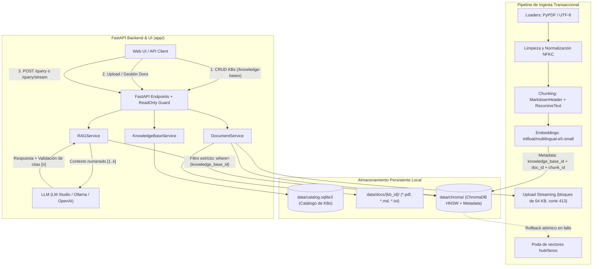

# TechnicalDoc AI Assistant

Asistente RAG para documentación técnica (`.md`, `.txt`, `.pdf`) con aislamiento multi-Knowledge Base, validación determinista de citas, streaming en tiempo real (SSE) y evaluación cuantitativa reproducible. Construido con **FastAPI**, **LangChain**, **ChromaDB**, **SQLite** y modelos de embeddings locales (`intfloat/multilingual-e5-small`).

---

## 📌 Estado del Proyecto: v1.0.0 (Fase 9 — Demo Pública, Evaluación Cuantitativa y Hardening)

- **Multi-Knowledge Base con Aislamiento Estricto:** Catálogo persistente en SQLite (`data/catalog.sqlite3`), filtro obligatorio por `knowledge_base_id` en ChromaDB, migración automática a la base `general` y selector interactivo en la interfaz web.
- **Confiabilidad y Anti-Alucinación:** Validación determinista de citas (`[n]`), poda de fuentes no referenciadas, reintentos guiados cuando el LLM olvida citar y abstención formal (`below_threshold`, `empty_knowledge_base`, `model_refused`, `no_citations`).
- **Ingesta Transaccional y Robusta:** Lectura de uploads en streaming por bloques de 64 KB con corte temprano (`413 Content Too Large`), detección de duplicados por hash SHA-256 (`409 Conflict`), indexado en lotes (`INDEX_BATCH_SIZE = 1000`) y rollback atómico de vectores ante fallos.
- **Embeddings Locales con Lazy Loading:** `intfloat/multilingual-e5-small` ejecutado localmente sin consumo de API y con carga diferida (`LazyEmbeddings`), reduciendo el arranque del catálogo y health checks a `< 0.25 s`.
- **Streaming SSE Unificado:** Respuestas token por token mediante Server-Sent Events (`POST /query/stream`) con contrato de cierre garantizado (`event: end` con fuentes, citas validadas y motivo de abstención).
- **Hardening para Demo Pública (`READ_ONLY_MODE`):** Modo de solo lectura (`READ_ONLY_MODE=true`) que bloquea mutaciones de bases de conocimiento y documentos con `403 Forbidden` (tanto en API como en la UI) manteniendo habilitadas todas las consultas RAG.
- **Observabilidad y Contenerización:** Sondas `/health`, `/health/live` (liveness + flag `read_only_mode`) y `/health/ready` (readiness verificando SQLite y ChromaDB), `Dockerfile` multi-stage con `uv` y CI en GitHub Actions (`.github/workflows/ci.yml`).

---

## 🏗️ Arquitectura del Sistema



---

## 📊 Evaluación Cuantitativa y Calibración RAG

El repositorio incluye un framework reproducible de evaluación (`scripts/evaluate.py` y `app/evaluation/`) sobre un dataset de **45 casos** (`eval/dataset.jsonl`) distribuidos en 3 Knowledge Bases técnicas (`kb-arquitectura`, `kb-redes`, `kb-python`), incluyendo consultas positivas con evidencia, preguntas fuera de dominio (negativas) y preguntas cruzadas entre bases (*cross-KB*).

### Resultados del Benchmark (`intfloat/multilingual-e5-small`)

| Métrica | Valor Obtenido | Descripción |
|---|---|---|
| **Recall@k** (`top_k=4`) | **100.00%** (30/30) | Proporción de consultas positivas donde el documento esperado aparece en el Top-K recuperado. |
| **MRR** (*Mean Reciprocal Rank*) | **1.0000** | El documento fuente correcto se posiciona en el rango `#1` en el 100% de los casos positivos. |
| **Refusal Accuracy** (Umbral calibrado) | **100.00%** (15/15) | Abstención exacta en consultas sin evidencia (negativas puras y consultas cruzadas a otra KB). |
| **Aislamiento entre KBs** | **100.00%** (45/45) | Cero fugas de fragmentos (`0` chunks contaminados) entre bases de conocimiento distintas. |
| **Latencia de Recuperación** | **26.73 ms** (p95: **36.70 ms**) | Búsqueda vectorial local + filtrado por `knowledge_base_id` en ChromaDB. |

> **Nota sobre calibración de `multilingual-e5-small`:** Debido a la anisotropía del espacio coseno en modelos de la familia E5, las similitudes nunca caen cerca de `0.0` (consultas fuera de dominio puntúan `0.71–0.79`, consultas cruzadas entre KBs técnicas puntúan `0.81–0.835` y aciertos reales puntúan `0.839–0.94`). El barrido empírico (`eval/reports/calibration_report.md`) demuestra que `chunk_size=500`, `top_k=3..4` y `min_relevance=0.837` (o `0.80` combinando abstención del LLM vía `NO_EVIDENCE`) maximizan tanto el Recall como la abstención.

Para reproducir la evaluación o ejecutar un barrido de calibración:
```powershell
# Evaluación estándar con reporte en eval/reports/latest_report.md
uv run python scripts/evaluate.py

# Barrido de hiperparámetros (chunk_size x top_k x min_relevance)
uv run python scripts/evaluate.py --calibrate
```

---

## 🚀 Inicio Rápido

### 1. Requisitos
- Python 3.12+
- [`uv`](https://github.com/astral-sh/uv) (gestor de paquetes y entorno virtual)
- [LM Studio](https://lmstudio.ai/) / Ollama con servidor local activo, o una API key compatible con OpenAI.

### 2. Instalación y Configuración
```powershell
# Instalar dependencias (incluyendo grupo dev)
uv sync --all-groups

# Crear el archivo de entorno
copy .env.example .env
```

Variables principales en `.env`:
```ini
LLM_PROVIDER=openai
OPENAI_API_KEY=lm-studio
OPENAI_BASE_URL=http://localhost:1234/v1
OPENAI_MODEL=tu-modelo-local
EMBEDDING_MODEL=intfloat/multilingual-e5-small
CHROMA_DIR=data/chroma
TOP_K=4
MIN_RELEVANCE=0.80
READ_ONLY_MODE=false
```

### 3. Cargar el Corpus Público de Demostración (Opcional)
Para poblar el sistema rápidamente con 3 bases de conocimiento de demostración (`kb-fastapi`, `kb-python-peps`, `kb-http-specs`) sin requerir conexión a internet:
```powershell
uv run python scripts/download_demo_docs.py --offline --ingest
```

También podés ingestar cualquier carpeta local hacia una Knowledge Base específica:
```powershell
uv run python scripts/ingest.py data/docs --kb general --kb-name "General"
```

### 4. Ejecutar el Servidor
```powershell
uv run uvicorn app.main:app --reload
```
- **Interfaz Web Multi-KB:** [http://localhost:8000/](http://localhost:8000/)
- **Swagger UI Interactivo:** [http://localhost:8000/docs](http://localhost:8000/docs)
- **Liveness / Readiness:** [http://localhost:8000/health/live](http://localhost:8000/health/live) · [http://localhost:8000/health/ready](http://localhost:8000/health/ready)

---

## 🐳 Despliegue con Docker y Modo Demo Pública (`READ_ONLY_MODE`)

El repositorio incluye un `Dockerfile` multi-stage optimizado con `uv`:

```powershell
# Construir la imagen
docker build -t technicaldoc-ai-assistant:1.0.0 .

# Ejecutar en modo normal con persistencia en volumen local
docker run --rm -p 8000:8000 -v "${PWD}/data:/app/data" --env-file .env technicaldoc-ai-assistant:1.0.0

# Ejecutar como Demo Pública en modo solo lectura (bloquea subidas y borrados con HTTP 403)
docker run --rm -p 8000:8000 -v "${PWD}/data:/app/data" -e READ_ONLY_MODE=true --env-file .env technicaldoc-ai-assistant:1.0.0
```

---

## 📡 Endpoints Principales de la API

### Salud y Observabilidad
| Método | Ruta | Descripción |
|---|---|---|
| `GET` | `/health` | Chequeo rápido de salud (`{"status": "ok"}`). |
| `GET` | `/health/live` | Liveness probe: versión del servicio y estado de `read_only_mode`. |
| `GET` | `/health/ready` | Readiness probe: verifica conectividad con el catálogo SQLite y ChromaDB (`200` o `503`). |

### Catálogo de Knowledge Bases
| Método | Ruta | Descripción |
|---|---|---|
| `GET` | `/knowledge-bases` | Lista todas las Knowledge Bases con conteo de documentos y chunks. |
| `POST` | `/knowledge-bases` | Crea una nueva KB (`201 Created`, `409` duplicada, `403` en modo solo lectura). |
| `GET` | `/knowledge-bases/{kb_id}` | Obtiene el detalle de una Knowledge Base (`404` si no existe). |
| `DELETE` | `/knowledge-bases/{kb_id}` | Elimina una KB, sus archivos y sus vectores (`204`, `400` si es `general`, `403` si solo lectura). |

### Gestión de Documentos (por Knowledge Base y ruta legada `/documents`)
| Método | Ruta | Descripción |
|---|---|---|
| `POST` | `/knowledge-bases/{kb_id}/documents` | Sube un archivo (`.md`, `.txt`, `.pdf`) por streaming y lo indexa en `kb_id` (`201`, `403`, `409`, `413`, `422`). |
| `GET` | `/knowledge-bases/{kb_id}/documents` | Lista los documentos indexados en `kb_id`. |
| `GET` | `/knowledge-bases/{kb_id}/documents/{doc_id}` | Detalle de un documento específico en `kb_id`. |
| `DELETE` | `/knowledge-bases/{kb_id}/documents/{doc_id}` | Elimina el documento del disco y sus vectores de ChromaDB (`204`, `403` en solo lectura). |

### Consulta RAG
| Método | Ruta | Descripción |
|---|---|---|
| `POST` | `/query` | Consulta síncrona en el ámbito de `knowledge_base_id` con citas validadas y latencia. |
| `POST` | `/query/stream` | Consulta en streaming SSE (`retrieved` → `token`* → `end`) con aislamiento por KB. |

Ejemplo de `POST /query`:
```json
{
  "question": "¿Cómo se configura el direccionamiento en subredes VLAN?",
  "knowledge_base_id": "kb-redes",
  "top_k": 4
}
```

---

## 🧪 Pruebas Automatizadas y Calidad de Código

La suite cuenta con **63 pruebas unitarias e integradas** que verifican ingesta transaccional, aislamiento entre Knowledge Bases, validación de citas, streaming SSE, reproducibilidad, evaluación cuantitativa y hardening `READ_ONLY_MODE` sin requerir conexión a internet ni LLMs externos:

```powershell
# Ejecutar toda la suite de tests
uv run pytest -q -W ignore

# Verificar estilo y linting con Ruff
uv run ruff check .
```

---

## 🗺️ Hoja de Ruta (Roadmap Completado)
- [x] **Fase 0**: Scaffold inicial con `uv` y typing estricto.
- [x] **Fase 1**: MVP Vertical Slice (Ingesta, ChromaDB, FastAPI `POST /query`).
- [x] **Fase 2**: Confiabilidad (Validación de citas, eliminación de citas falsas, manejo de errores `503`/`409`).
- [x] **Fase 2.5**: Streaming en tiempo real vía Server-Sent Events (SSE).
- [x] **Fase 3**: Gestión de documentos vía API (`POST/GET/DELETE /documents`).
- [x] **Fase 4**: Frontend interactivo propio servido en FastAPI.
- [x] **Fase 5**: Robustez de ingesta (upload en streaming, rollback atómico, indexado por lotes, contrato SSE unificado).
- [x] **Fase 6**: Soporte multi-Knowledge Base (aislamiento estricto y catálogo SQLite).
- [x] **Fase 7**: Evaluación cuantitativa RAG (Recall@k, MRR, abstención, aislamiento y calibración de umbrales).
- [x] **Fase 8**: Reproducibilidad, CI/CD y contenerización (Docker, GitHub Actions, corpus demo).
- [x] **Fase 9**: Hardening para demo pública (`READ_ONLY_MODE`, `/health/live`, `/health/ready` y documentación de portfolio).
